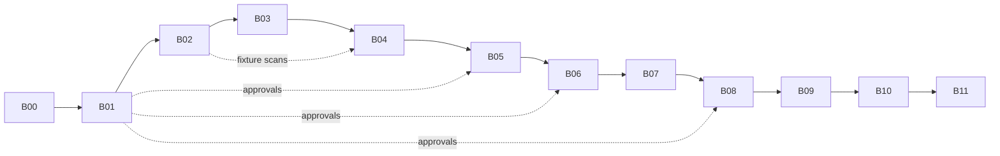

# Build plan — B00 to B11

Each file in this folder is **one session of work** for Claude Code or Codex. Do them in order. Each ends
with tests passing, `PROJECT_STATUS.md` + `SESSION_LOG.md` updated, and a commit.

## How to run a step

| Where | What you type |
| --- | --- |
| Claude Code (VS Code / desktop / **cloud**) | `/build B00` — or paste the whole `build/B00_bootstrap.md` |
| Codex (VS Code / CLI) | `Follow prompts/build.md with ARGS = B00` — or paste the file |

After each step: read the diff, run the Verify commands yourself once, then move on. If you're spending
cloud credits, see `docs/14_CLOUD_CREDITS_AND_USAGE.md` (column "Cloud?" below).

| Step | File | Produces | Cloud? | Suggested tool / model | Paid calls |
| --- | --- | --- | --- | --- | --- |
| B00 | [B00_bootstrap.md](B00_bootstrap.md) | uv project, git, settings, demo client, verified tool docs | ✅ | Claude Code · Sonnet | No |
| B01 | [B01_contracts_validator_approvals_budget.md](B01_contracts_validator_approvals_budget.md) | JSON Schemas, validator, approvals, budget | ✅ | Claude Code · Sonnet/Opus | No |
| B02 | [B02_grid_metrics_heatmaps.md](B02_grid_metrics_heatmaps.md) | grid, geocode, fixture scans, metrics, heatmaps | ✅ | Codex or Claude · Sonnet | No |
| B03 | [B03_dataforseo_adapter.md](B03_dataforseo_adapter.md) | rank_scan.py live adapter | ✅ code / ❌ live test | Claude Code · Sonnet | ≤ US$2 (local only) |
| B04 | [B04_keywords_competitors_prospect_audit.md](B04_keywords_competitors_prospect_audit.md) | competitors.py, niche playbooks, /audit-prospect | ✅ | Claude Code · Opus | No |
| B05 | [B05_gbp_agents_compliance.md](B05_gbp_agents_compliance.md) | GBP template, category notes, lint_claims | ✅ | Claude Code · Opus | No |
| B06 | [B06_website_template_and_checks.md](B06_website_template_and_checks.md) | Astro template, schema_gen, site_check, deploy.sh | ✅ | **Codex** · strong | No |
| B07 | [B07_citations.md](B07_citations.md) | Canadian directory list, nap_check | ✅ | Claude Code · Sonnet | No |
| B08 | [B08_reviews_content_links.md](B08_reviews_content_links.md) | review card, message templates, demo outputs | ✅ | Claude Code · Sonnet | No |
| B09 | [B09_reporter_orchestrator.md](B09_reporter_orchestrator.md) | report template, number check, make_sprint, /sprint | ✅ | Claude Code · Opus | No |
| B10 | [B10_dry_run_and_live_pilot.md](B10_dry_run_and_live_pilot.md) | clean-clone dry run; live baseline on a pilot | ❌ local | Claude Code · Sonnet | ≤ US$10 |
| B11 | [B11_independent_audit.md](B11_independent_audit.md) | audit + fixes, acceptance tests A01–A14 | ✅ | **the other tool** · strongest | No |

Rough total: 45–60 hours of your steering/reviewing time.

## Universal rules for every step (the AI must follow these)

```text
Implement ONLY the named build step in this repository.
First read: AGENTS.md, PROJECT_STATUS.md, DECISIONS.md, the last SESSION_LOG.md entry, this build file,
and every docs/ file it names. Run git status.
Keep unrelated work intact. Python 3.12 with uv for tools/, pytest for tests, Astro for site templates.
Fixture mode only unless the step explicitly allows a capped live call.
Never invent provider results, business facts or ranking outcomes.
Every script: CLI with --help, type hints, deterministic, unit-tested with pytest, no network in tests,
paths relative to repo root, works on Windows and Linux.
Agents propose; they never apply external changes. Only tools/ scripts make network calls.
When done: run `uv run pytest -q` and `uv run python tools/validate.py clients/_demo-barber`
(once validate.py exists), update PROJECT_STATUS.md (implemented / stubbed / blocked), append
SESSION_LOG.md (files changed, commands run, real results, gaps, next step), commit "Bxx: <summary>".
If docs contradict each other or seem outdated, stop and record the question in DECISIONS.md.
```

## Flow of the build



B06, B07 and B08 only depend on B01/B05, so if you're in a hurry they can run in parallel sessions on
separate branches (they touch different files). Merge before B09.
