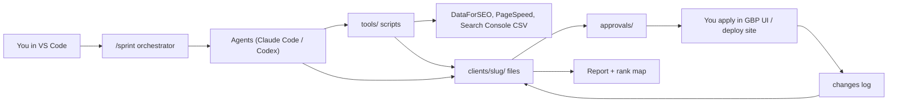

# System architecture

## 1. Design principles

1. **Agents propose, scripts measure, humans approve, humans (or approved scripts) publish.**
2. **Numbers come from code, never from a model.** Rank positions, review counts, distances, averages and
   percentages are computed by scripts in `tools/`. Agents read those outputs and explain them.
3. **The repo is the memory.** Any agent in Claude Code or Codex can resume because everything lives in
   files: client facts, scans, decisions, approvals, session logs.
4. **One canonical spec per agent**, tool-agnostic, in `agents/`. Claude Code and Codex get thin wrappers
   that point at it (09). Change an agent once; both tools follow.
5. **Nothing touches a real Google profile or live website without an approval file** matching the exact
   change (06 §7).
6. **No runtime server, no database, no API-billed LLM** at this stage. Paid external calls are only the
   rank-data provider (DataForSEO) and optional citation tooling, each with a hard monthly cap.

## 2. Big picture



## 3. Repository layout

```text
maps-rank-studio/
├── CLAUDE.md                 # Claude Code project instructions (imports AGENTS.md)
├── AGENTS.md                 # Codex + shared rules (single source of rules)
├── PROJECT_STATUS.md         # what exists / stubbed / next
├── DECISIONS.md              # dated decisions
├── SESSION_LOG.md            # one entry per session
├── docs/                     # this pack (00–14)
├── build/                    # B00–B11 build step files
├── agents/                   # CANONICAL agent specs (one .md per agent, see 04)
│   ├── orchestrator.md
│   ├── intake.md
│   ├── keyword-competitor.md
│   ├── gbp-auditor.md
│   ├── gbp-optimizer.md
│   ├── site-builder.md
│   ├── site-auditor.md
│   ├── citation.md
│   ├── review-engine.md
│   ├── content.md
│   ├── link-prospector.md
│   ├── rank-tracker.md
│   ├── reporter.md
│   └── compliance-reviewer.md
├── .claude/
│   ├── agents/               # thin Claude Code subagent wrappers -> agents/*.md
│   ├── commands/             # /sprint, /scan, /audit, /report, /status
│   └── settings.json         # permissions (deny secrets, deny pushes to live)
├── prompts/                  # Codex-friendly prompt files mirroring the commands
├── knowledge/                # shared reference the agents load
│   ├── ranking-rules.md      # copy of 02 §3–7 in agent-ready form
│   ├── gbp-categories/       # category notes per niche
│   ├── citations-canada.csv  # directory list (name, url, niche, priority, notes)
│   └── niche-playbooks/      # barber.md, pest-control.md, ...
├── templates/
│   ├── site/                 # Astro starter for client sites
│   ├── report/               # HTML report template
│   ├── review-card/          # printable QR card
│   └── messages/             # review request texts, owner emails
├── tools/                    # deterministic Python CLI scripts
│   ├── grid.py               # build N×N grid of coordinates around a point
│   ├── rank_scan.py          # DataForSEO Maps + organic scans, cached, budgeted
│   ├── heatmap.py            # render grid to PNG/HTML
│   ├── metrics.py            # ARP, top-3 share, SoLV, deltas
│   ├── competitors.py        # extract competitor table from scan
│   ├── nap_check.py          # compare NAP strings across citations
│   ├── site_check.py         # Lighthouse/PageSpeed + schema validation
│   ├── schema_gen.py         # LocalBusiness JSON-LD from facts
│   ├── approvals.py          # create/verify/consume approval files (digest-bound)
│   ├── budget.py             # spend ledger and caps
│   ├── validate.py           # JSON-schema validation for every client file
│   └── ...                   # geocode, fixture_scan, lint_claims, review_card, render_report,
│                             # check_report_numbers, make_sprint, deploy.sh — see 10
├── schemas/                  # JSON Schemas for the files in 06
├── clients/                  # one folder per client (PRIVATE — see §7)
│   └── _demo-barber/         # synthetic fixture client, clearly marked
└── tests/
```

## 4. How a unit of work runs

```text
operator: /sprint kings-barbers day-3
  orchestrator:
    read clients/kings-barbers/sprint.json  -> what's due today
    for each due task:
      check prerequisites (files exist, schema-valid, approvals where needed)
      run the owning agent with ONLY: its spec + knowledge files + that client's files
      agent calls tools/ scripts for any measurement
      agent writes outputs to the client folder (proposals, never live changes)
      compliance-reviewer checks every proposal against knowledge/ranking-rules.md
      task -> awaiting_approval | done | blocked (with reason)
  orchestrator prints: done / waiting for you / blocked, and the exact next human action
```

The orchestrator does not "loop until the business ranks". It executes the tasks due on a given sprint
day, then stops.

## 5. Modes

Every client folder has `mode` in `client.yaml`:

| Mode | Allowed |
| --- | --- |
| `fixture` | Synthetic data, cached/fake scan results, no paid calls, no real profiles |
| `pilot` | Real business with written permission, paid scans within the pilot cap |
| `production` | Paying client, full playbook, approvals required for every external change |

`tools/rank_scan.py` refuses paid calls in `fixture` mode. Fixture outputs carry `"synthetic": true` and the
report template prints a SYNTHETIC banner.

## 6. Who executes external changes

| Change | v1 executor | Later |
| --- | --- | --- |
| GBP edits (categories, services, description, hours, photos, posts) | **You**, in the GBP web UI using Manager access, following the approved change sheet | GBP API once access is approved by Google (prereqs: verified profile active 60+ days, application) |
| Owner replies to reviews | You (Manager) or owner, from approved drafts | API later |
| Website deploy | `tools/deploy.sh` run by you after approval (Cloudflare Pages) | CI on merge to `main` with approval check |
| Citations | You or the owner, manually, from the citation task list | Paid aggregator if volume justifies |
| Review requests to customers | **Owner** sends (they have the relationship and consent) | — |

Browser automation of Google's UI is out of scope: it risks account flags and Google's terms.

## 7. Data handling

- `clients/` holds personal info (owner names, phones, review text). Keep the whole repo **private**,
  or put `clients/` in a separate private repo / encrypted folder. Never commit API keys: they go in `.env`
  (git-ignored) and Claude Code's settings deny reading `.env*` in agent sessions except via tools.
- Don't store customers' personal data (the people who get review requests). The owner sends requests from
  their own phone/system; you only store counts.
- On offboarding: export the client folder to the client, then delete within 30 days (11).

## 8. Why not a hosted app / multi-agent framework now

One operator, up to ~10 clients, and work that is mostly weekly batches: files + scripts + interactive
agents are enough, cost nothing extra, and keep you in the loop on every external change. Revisit when:
more than ~10 clients, or the GBP API is approved and you want scheduled posting, or a second operator
joins. The file contracts in 06 are deliberately shaped so they can later become database tables.
