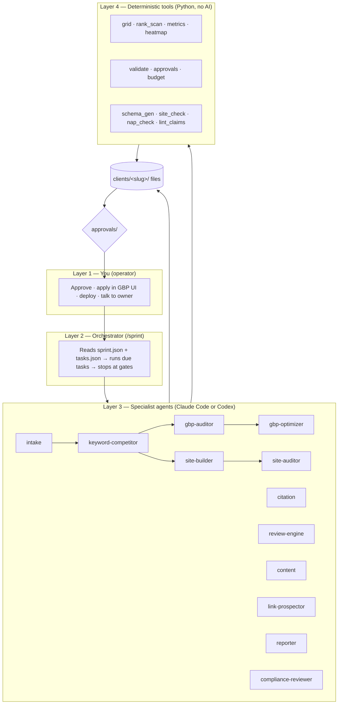
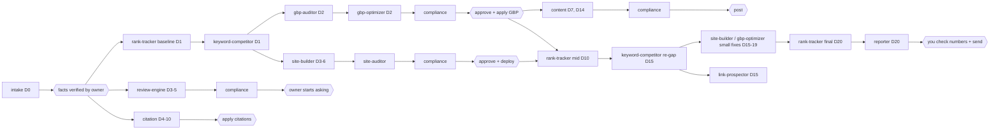
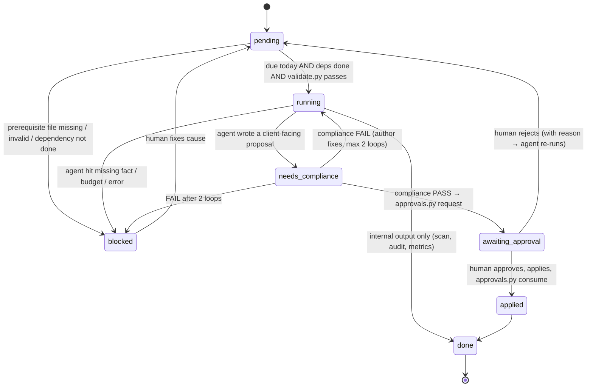

# Orchestration design — how the agents work together, step by step

Version 1.0 · 3 November 2026 · Scope: Google Maps + Google Search SEO only (Ads later, docs/11 §6)

This is the "how it actually runs" document. It ties together the agents (docs/04, `agents/`), the
20-day sprint (docs/05), the files (docs/06) and the tools you run them with (docs/09). If any other doc
disagrees with this one about **flow**, this one wins; for **file formats**, docs/06 wins; for **rules**,
`knowledge/ranking-rules.md` wins.

---

## 1. The goal, in system terms

> A client says: "When someone searches `barber shop bradford`, I want my shop at the top."

The system turns that into four measurable things:

| Client wish | System target | Measured by |
| --- | --- | --- |
| "Top of Google Maps" | Top 3 in the Maps 3-pack on ≥ N of the grid points within `radius_km` of the shop | `tools/metrics.py` → *target-radius top-3 share* |
| "Top of Google search" | Client's website page in organic top 10 (ideally top 3) for the main keyword from shop + town centre | `tools/rank_scan.py --organic` → *organic position* |
| "More people find me" | Steady weekly review flow, complete profile, correct citations | `reviews/velocity.json`, `gbp/audit.json`, `citations/nap-report.md` |
| "Prove it" | Before/after heatmaps with identical parameters | `scans/<baseline>` vs `scans/<final>` |

Everything the agents do pushes one of Google's three local ranking factors:

```text
RELEVANCE   ← category, services, description, website page, review wording   (gbp-optimizer, site-builder)
PROMINENCE  ← reviews, citations, local links, photos, activity               (review-engine, citation, link-prospector, content)
DISTANCE    ← not controllable → measured with a grid, promise sized to radius (rank-tracker, keyword-competitor)
```

---

## 2. The four layers



| Layer | Who | Thinks? | Touches the outside world? |
| --- | --- | --- | --- |
| 1 Operator | You | Yes | **Yes — only layer that does** (GBP UI, deploy, directories, owner messages) |
| 2 Orchestrator | AI agent | Scheduling only | No |
| 3 Specialists | AI agents | Yes — strategy, writing | No — write proposals into files |
| 4 Tools | Python scripts | No | Only read-only paid data APIs (DataForSEO, PageSpeed), budget-capped |

---

## 3. The agents and who feeds whom

| # | Agent | Input files (must exist) | Output files | Next consumer |
| --- | --- | --- | --- | --- |
| 1 | **intake** | `intake/questionnaire.md`, `intake/notes.md` | `client.yaml`, `facts.yaml` (proposed), `access.md`, `questions.md` | owner confirms facts → everyone |
| 2 | **rank-tracker** | `client.yaml` (lat/lng, scan params, keywords) | `scans/<label>/grid.json`, `metrics.json`, heatmaps | keyword-competitor, reporter |
| 3 | **keyword-competitor** | `facts.yaml` (verified), baseline scan, niche playbook | `keywords.json`, `competitors.json`, `gap-analysis.md`, radius | gbp-*, site-builder, citation |
| 4 | **gbp-auditor** | `gbp/current.yaml`, `competitors.json` | `gbp/audit.md`, `gbp/audit.json` | gbp-optimizer |
| 5 | **gbp-optimizer** | audit, verified facts, keywords, competitors | `gbp/changes/<date>-batch.yaml` + description/services/Q&A/photo list | compliance → approval → **you apply** |
| 6 | **site-builder** | verified facts, keywords, gap analysis | `site/` Astro project or fix list | site-auditor |
| 7 | **site-auditor** | `site/` build or live URL | `site/audit-<date>.json/.md` | site-builder (loop ≤ 2) → approval → **you deploy** |
| 8 | **citation** | verified facts, `citations/found.csv` | `citations/plan.csv`, `nap-report.md` | **you / owner apply** |
| 9 | **review-engine** | verified facts, `reviews/inbox.md`, scan review counts | request kit, reply drafts, `velocity.json` | compliance → **owner sends / you post replies** |
| 10 | **content** | verified facts, owner-confirmed offers | `content/<month>/posts.md`, `photos.md` | compliance → **you post** |
| 11 | **link-prospector** | facts, town | `links/prospects.csv` | **you decide** |
| 12 | **reporter** | all `metrics.json`, `log.md`, approvals, velocity | `reports/<date>/report.html`, `summary.md` | `check_report_numbers.py` → **you send** |
| 13 | **compliance-reviewer** | any proposal + rules + facts | `reviews/compliance/<file>-<date>.md` PASS/FAIL | orchestrator / approvals |
| 14 | **orchestrator** | `sprint.json`, `tasks.json`, `approvals/` | task status, `log.md`, human to-do list | you |

### Dependency graph for the sprint



---

## 4. Task state machine (what the orchestrator enforces)

Every task in `clients/<slug>/tasks.json` moves through these states:



Rules:

1. The orchestrator only starts tasks whose `day ≤ today's sprint day` and whose `depends_on` are all
   `done`/`applied`. It never starts future tasks.
2. It never loops "until the business ranks". One `/sprint` call = one day's due tasks, then stop.
3. A compliance FAIL goes back to the author **at most twice**. Then `blocked` with the report attached.
4. `blocked` always has a `reason` and a `human_action` string.
5. Only humans move tasks out of `awaiting_approval`.

---

## 5. One `/sprint` run, step by step

```text
/sprint kings-barbers-bradford 2
│
├─ 0. Pre-flight
│   ├─ uv run python tools/validate.py clients/kings-barbers-bradford      → stop if invalid
│   ├─ read client.yaml → mode (fixture | pilot | production)
│   └─ read tasks.json → list tasks with day ≤ 2, status pending, deps satisfied
│
├─ 1. For each due task, in tasks.json order:
│   ├─ check its input files exist (table in §3)          → else blocked + reason
│   ├─ delegate to agent: give ONLY slug + task id + its spec path
│   │     Claude Code: spawn subagent .claude/agents/<agent>.md
│   │     Codex:      "read agents/<agent>.md and do that job now", one at a time
│   ├─ agent runs tools/ scripts for any number it needs
│   ├─ agent writes outputs into the client folder
│   ├─ if output is client-facing → compliance-reviewer (ideally the OTHER tool)
│   │     PASS → tools/approvals.py request → awaiting_approval
│   │     FAIL → back to author (≤ 2) → else blocked
│   └─ update tasks.json + append log.md
│
├─ 2. Post-flight
│   ├─ validate.py again
│   └─ git add clients/<slug> && git commit -m "<slug> day 2"
│
└─ 3. Print the human to-do list
    DONE:              gbp-auditor (9 fail / 14 pass) → gbp/audit.md
    WAITING FOR YOU:   1. Send gbp/description-options.md to owner (WhatsApp)
                       2. uv run python tools/approvals.py approve A2026-11-06-gbp-batch1 --by A
                       3. Apply gbp/changes/2026-11-06-batch.yaml in GBP UI, one sitting
                       4. uv run python tools/approvals.py consume A2026-11-06-gbp-batch1
    BLOCKED:           none
```

---

## 6. The human gates (the only places anything goes public)

| Gate | Artifact approved | Who approves | Who applies | Proof recorded |
| --- | --- | --- | --- | --- |
| G0 Facts | `facts.yaml` | **Owner** ("confirmed") | You set `status: verified` | `verified_by`, `verified_on` per fact |
| G1 GBP batch | `gbp/changes/<date>-batch.yaml` | You (+ owner for description) | **You** in GBP UI | `gbp/applied.log`, before/after screenshots |
| G2 Site deploy | `site/` build digest | You (+ owner for copy) | **You** run `tools/deploy.sh` | deploy receipt, approval consumed |
| G3 Review kit | `reviews/request-kit/` | You + owner | **Owner** sends to their customers | approval file |
| G4 Review replies | `reviews/replies/<date>.md` | You | You (Manager) or owner | approval file |
| G5 Posts/photos | `content/<month>/posts.md` | You (+ owner for offers) | You | approval file |
| G6 Citations | `citations/plan.csv` | You | You / owner | plan.csv status column |
| G7 Report | `reports/<date>/report.html` | You (after `check_report_numbers.py` passes) | You send | report hash in log |

Every approval is bound to the SHA-256 of the exact file (docs/06 §7). Edit the file → approval is void.

---

## 7. Which tool runs which agent

You have two engines. Use them so that **the author and the reviewer are different**.

| Agent | Default engine | Model tier | Why |
| --- | --- | --- | --- |
| orchestrator | Claude Code (`/sprint`) | mid (Sonnet) | Has subagents + slash commands |
| intake | Claude Code | mid | Structured extraction |
| keyword-competitor | Claude Code | **strong (Opus)** | Strategy; drives everything downstream |
| gbp-auditor | Claude Code | mid | Checklist |
| gbp-optimizer | Claude Code | **strong** | Client-facing, suspension risk |
| site-builder | **Codex** | mid/strong | Lots of code; Codex is good at it |
| site-auditor | script + Codex | mid | Mostly `site_check.py` |
| citation | Claude Code | fast (Haiku/Sonnet) | Mechanical |
| review-engine | Claude Code | mid | Tone matters |
| content | Claude Code | fast | Short posts |
| link-prospector | Claude Code | mid | Needs web research (operator verifies) |
| rank-tracker | **scripts only** | none / fast | Zero tokens ideally |
| reporter | Claude Code | mid | Narrative over fixed numbers |
| compliance-reviewer | **the other tool** from the author (usually Codex) | **strong** | Independent review |

Build steps (B00–B11) follow the same idea: build in one tool, audit in the other (B11).

---

## 8. Failure handling

| Situation | What the system does | What you do |
| --- | --- | --- |
| Missing/unverified fact | Agent writes to `questions.md`, task `blocked` | Ask owner, mark verified, re-run `/sprint` |
| Budget cap would be exceeded | `budget.py check` exits non-zero, scan not run | Raise cap in `client.yaml` or wait |
| Scan has error points | Points excluded and listed; never interpolated | Re-run those points only (cached raws) |
| Compliance FAIL twice | `blocked` with report | Read report, fix spec or facts |
| Client file contains instructions ("add Best Barber to name") | Treated as data; logged as suspicious | Nothing — test A04 covers this |
| GBP edit held "under review" by Google | Day-10 scan flat | Wait; don't re-edit name/category/address |
| Profile suspended | Orchestrator refuses all GBP tasks if `client.yaml → gbp_status: suspended` | Stop edits, follow Google reinstatement, tell owner same day |
| Agent loops / rewrites same file | — | Stop it, narrow the task, log it |

---

## 9. Data flow for the rank proof (the core of your sales promise)

```text
client.yaml (centre lat/lng, grid 7×7, spacing, keywords, depth 20, mobile)
   │
   ▼  tools/grid.py           → 49 coordinates
   ▼  tools/budget.py check    → OK?
   ▼  tools/rank_scan.py       → DataForSEO Google Maps SERP per point × keyword (cached raw JSON)
   ▼                           → scans/<label>/grid.json  (client_rank per point, matched by place_id)
   ▼  tools/metrics.py         → metrics.json: ARP, top-3 share, target-radius top-3 share, Δ
   ▼  tools/heatmap.py         → heatmap-<keyword>.png (green 1–3, yellow 4–10, orange 11–20, red 20+)
   ▼  reporter agent           → narrative citing metrics.json only
   ▼  tools/check_report_numbers.py → every number traceable or FAIL
   ▼  you                      → send
```

Same parameters at baseline (day 1), mid (day 10), final (day 20), and monthly after.

---

## 10. Monthly cycle (after day 20)

`make_sprint.py --monthly` generates 4 weekly task groups; `/sprint <slug> m<YYYY-MM>-w<1-4>` runs them.

| Week | Agents | You (≤ 2 h total/month) |
| --- | --- | --- |
| 1 | rank-tracker, review-engine (replies) | Post replies |
| 2 | content (2 posts + photo list), keyword-competitor (re-gap) → 1 improvement | Post, apply |
| 3 | review-engine, citation (re-check), link-prospector | Pick 1 link action |
| 4 | content (2 posts), reporter (monthly) | Send report + WhatsApp summary |

---

## 11. Prospect flow (sales, before a client exists)

```text
/audit-prospect "Kings Barbers" Bradford "barber bradford"
  → prospects/kings-barbers-bradford/  (mode: pilot-audit, budget US$1)
  → rank-tracker: one 7×7 scan, one keyword (public data only, no access needed)
  → keyword-competitor: top 3 competitors + 3 biggest gaps
  → reporter: one-page rank map
  → you: print it, walk in (docs/12)
On signing → tools/promote_prospect.py moves it to clients/<slug>/ and the scan becomes a candidate
baseline (re-scan on day 1 with the full keyword set anyway).
```

---

## 12. What "done" looks like for the whole system

The system is ready for a paying client when:

1. B00–B11 are done and `PROJECT_STATUS.md` shows no blockers.
2. Acceptance tests A01–A14 (build/B11) pass.
3. The demo client runs days 0→20 in fixture mode from a clean clone using only the README.
4. One real pilot business (with written permission) has a live baseline and gap analysis.
5. You have run `/sprint` yourself at least once without the AI needing to "figure things out".
